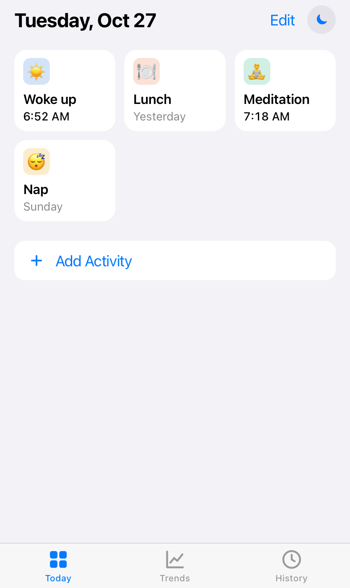
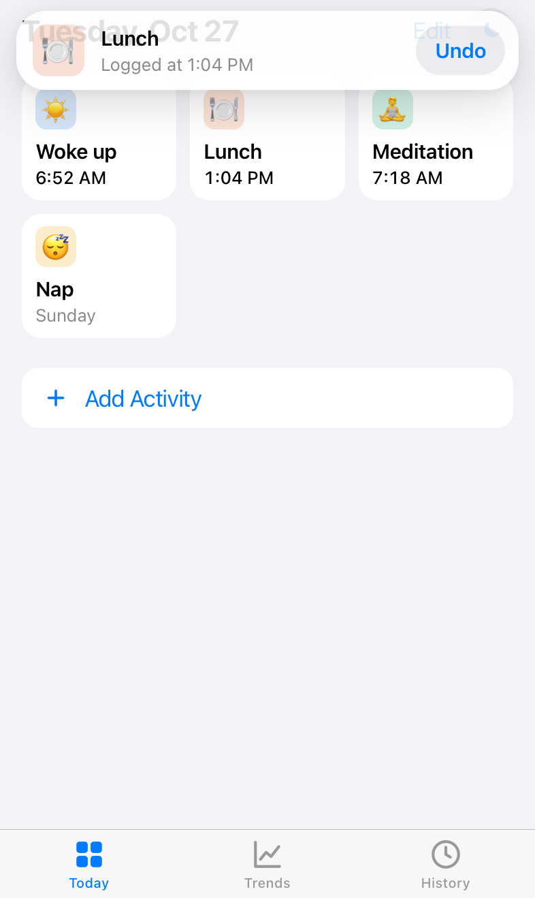
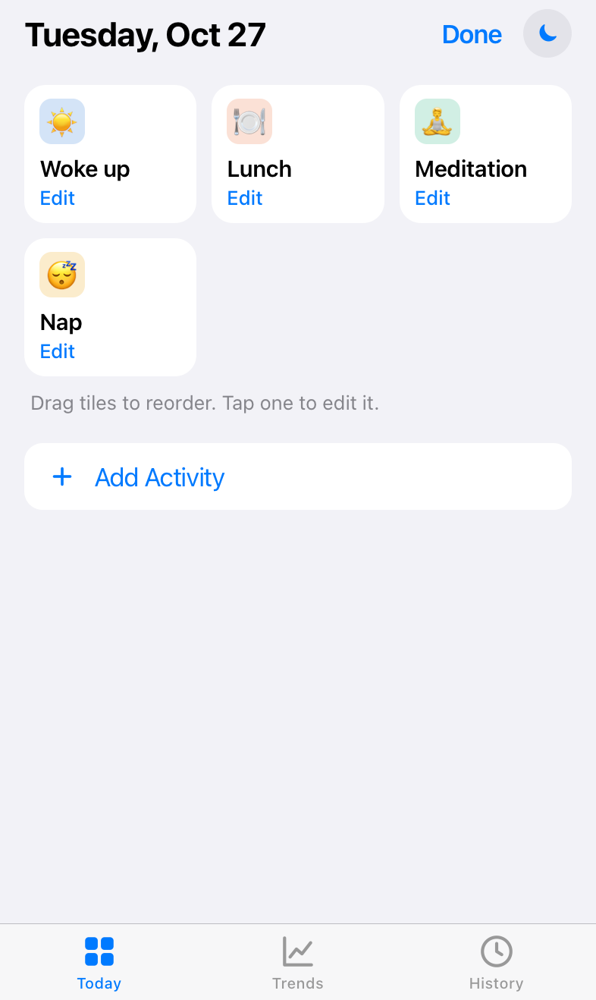
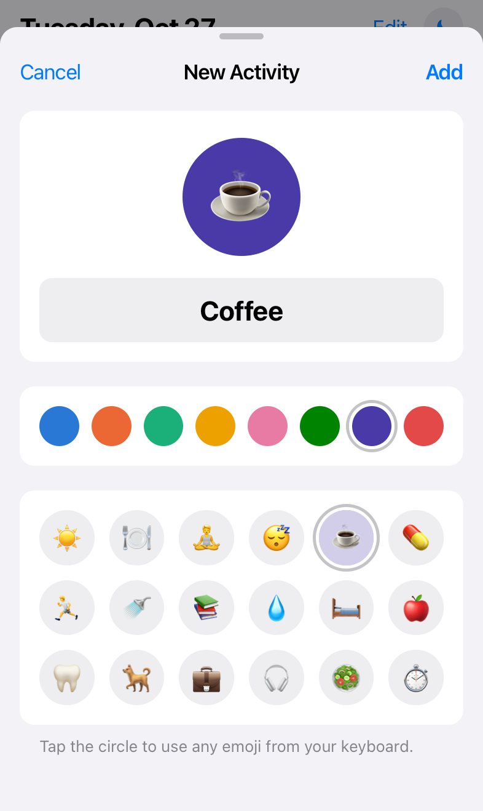
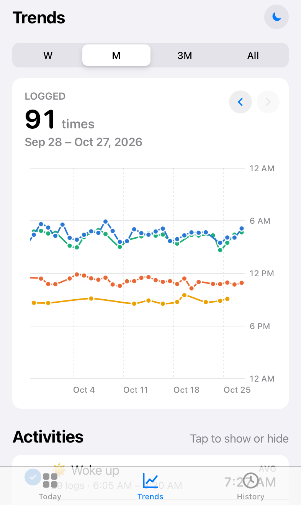
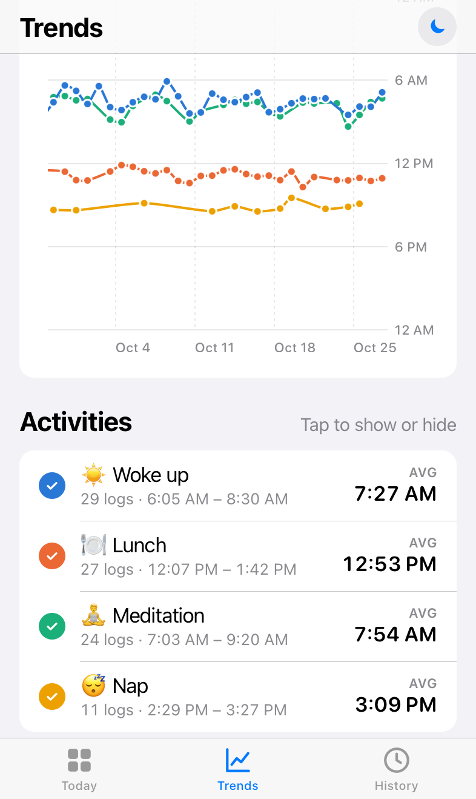
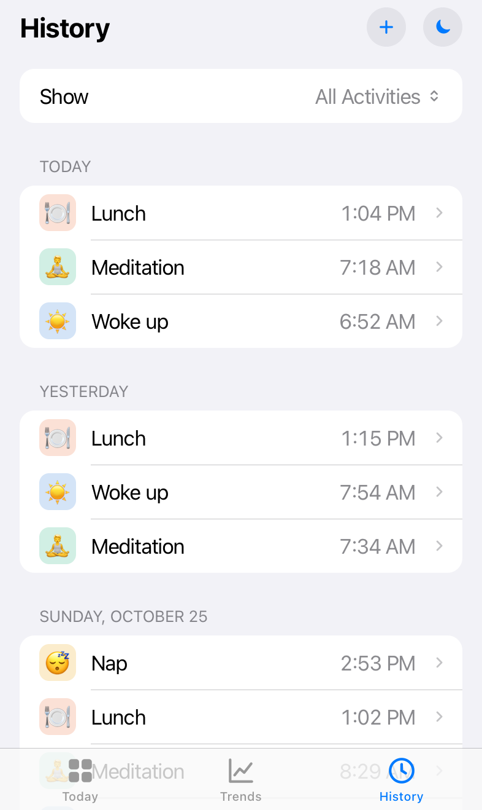
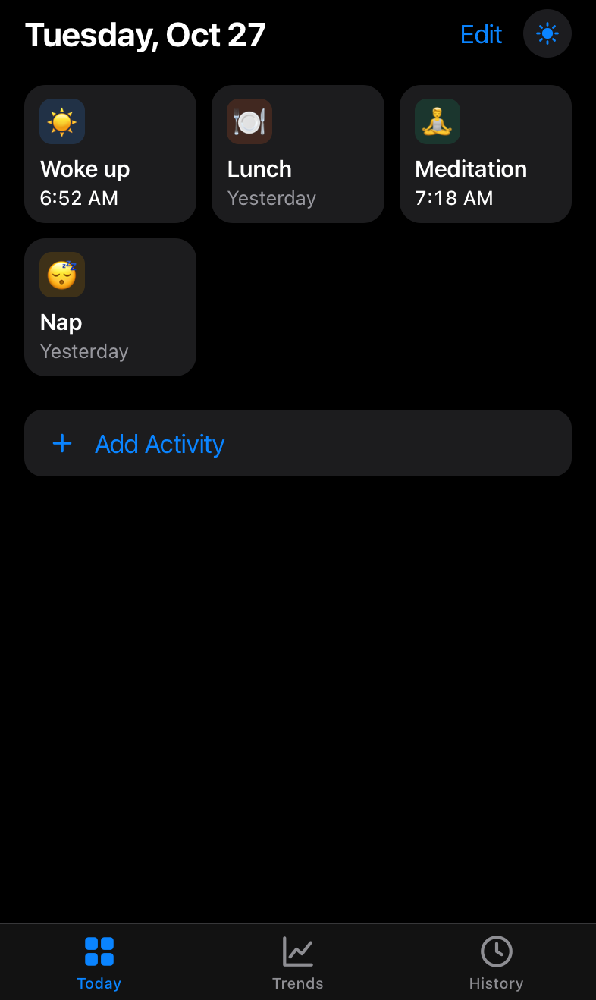
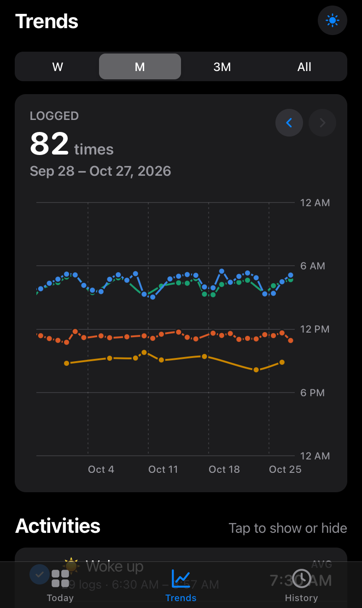

# Stampio

Stampio is a tiny web app for logging when things happen like wake-up, lunch, meditation, naps, anything.

https://stampio.netlify.app

<p align="center">
  
  
  
</p>
<p align="center">
  
  
  
</p>
<p align="center">
  
  
  
</p>

## Features

- **Today**: one card per activity showing the last logged time. Tap a card to log now, with a haptic tap on iOS 18 and a banner you can **Undo**. **Edit** to drag tiles into a new order, or tap one to rename, recolor or delete it; **Add Activity** to create one.
- **Trends**: one line per activity, with the day across and the time of day down. Switch between week, month, 3 months and all time, and swipe (or use the arrows) to page back through earlier periods. The list under the chart toggles each line and shows its average time and usual range.
- **History**: every logged time grouped by day, filterable by activity. Tap one to change or delete it, or **+** to add one you missed. **Export as CSV** / **Import from CSV** (import merges and skips duplicates — handy for backups). **Delete All Data** wipes activities and entries after a confirmation.
- **Light and dark** appearance (light by default), using Apple's system colors.
- Times follow the device's 12/24-hour setting.

All data lives in `localStorage` on the device. Nothing is sent anywhere.


## Develop

```sh
pnpm install
pnpm dev         # http://localhost:5173 (also printed with your LAN IP)
pnpm build       # outputs static files to dist/
pnpm icons       # regenerate the app icon and favicon from scripts/make-icons.mjs
```

To try it on your phone, open the LAN address that `pnpm dev` prints while on the same Wi-Fi.


**Notes**
- The home-screen app has its **own storage**, separate from Safari. Data logged in Safari won't appear in the installed app, and the other way round.
- Export a CSV now and then as a backup. Deleting the home-screen app deletes its data.
- Keep using the same URL: storage is tied to the site's address.

## CSV format

```
activity,timestamp,date,time,weekday,emoji,color
Lunch,,,,,🍽️,#d95926
Nap,,,,,😴,#d55181
Lunch,2026-10-26T12:41:07+01:00,2026-10-26,12:41:07,Mon,🍽️,#d95926
```

The first rows (blank timestamp) list every activity in home-screen order, so activities with nothing logged yet, plus their emoji and color, are kept. Import only needs the `activity` and `timestamp` columns; it adds missing activities and moves the file's activities to the front in the file's order.
